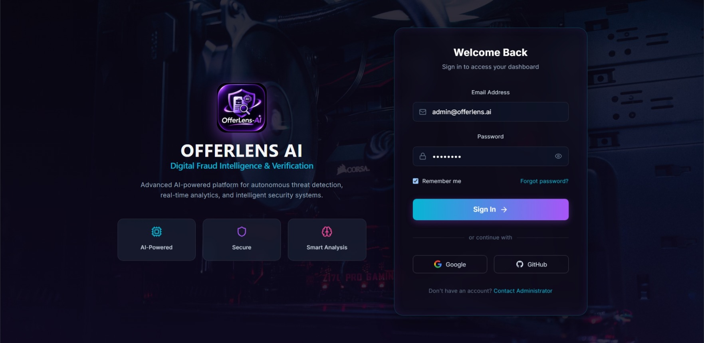
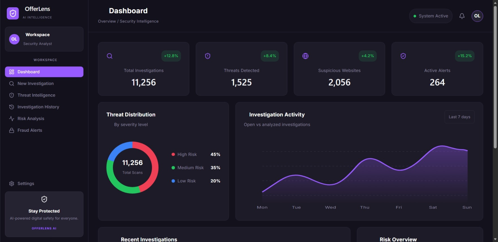
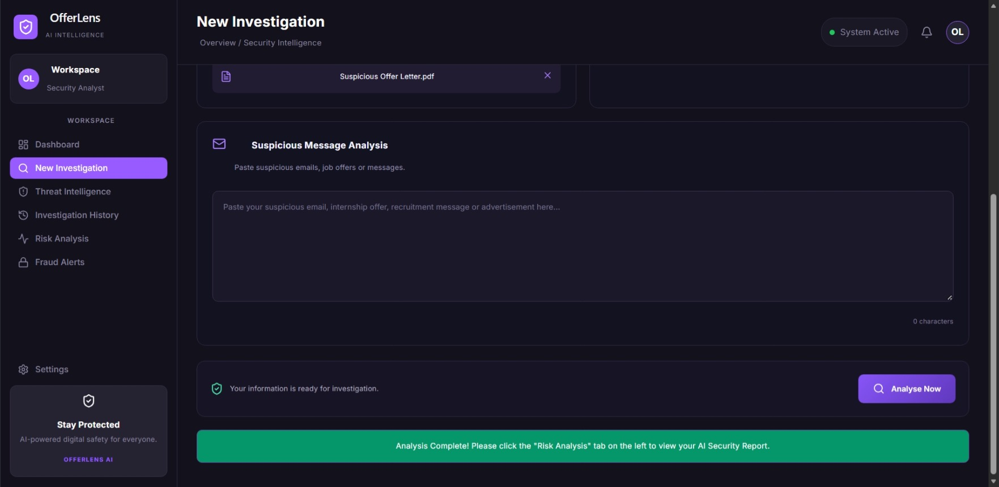
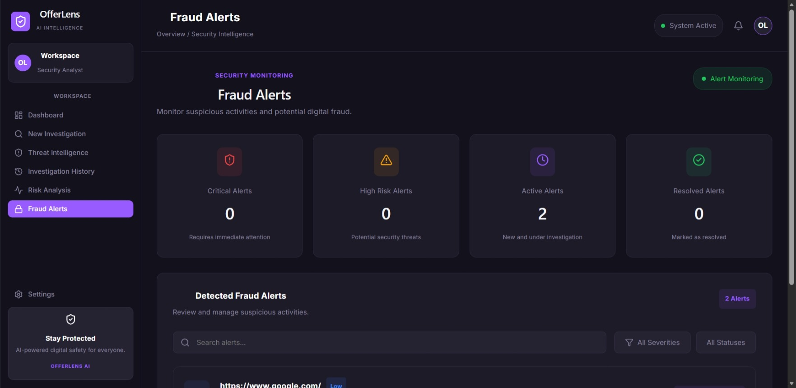
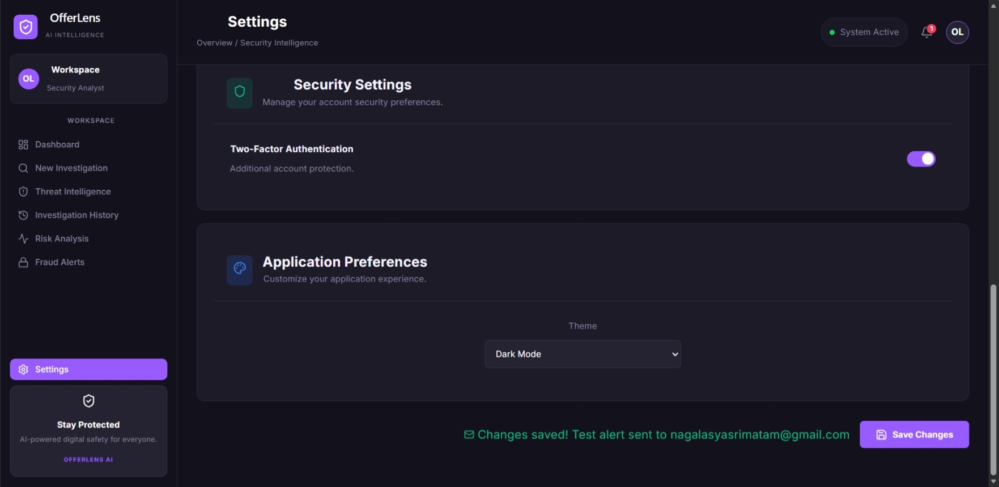

# 🛡️ OfferLens AI — Digital Fraud Intelligence & Offer Verification

[](https://github.com)
[](https://fastapi.tiangolo.com/)
[](https://react.dev/)
[](LICENSE)

> **OfferLens AI** is an autonomous threat intelligence and fraud verification platform designed to detect fraudulent employment offers, phishing domains, and recruitment scams using real-time content analysis, risk scoring, and automated threat notifications.

---

## 🌟 Key Features

- **Autonomous Offer Verification:** Scans offer letters, recruitment emails, and URLs against threat heuristics to calculate real-time fraud risk scores.
- **Dynamic Threat Intelligence Dashboard:** Interactive SOC metrics, severity distribution, and weekly activity monitoring.
- **Real-Time Fraud Alerts & SOC Triage:** Synchronized alert database with live status toggling (`New`, `Investigating`, `Resolved`) and notification management.
- **Automated Incident Dispatch:** Real-time email dispatch alerting users and security analysts when high-risk or critical threats are detected.
- **Role-Based Authentication Gateway:** Secure glassmorphic landing experience protecting the workspace environment.

---

## 📸 System Showcase

<div align="center">
  
</div>

### 1. Authentication & Security Gateway
*Secure access portal featuring modern glassmorphism and integrated security controls.*



### 2. Security Operations Dashboard
*Live KPI tracking, severity distribution donuts, and recent investigations activity.*



### 3. Investigation Scanner & Risk Engine
*Detailed risk scoring, scam flag extraction, and automated safety verdicts.*



### 4. Real-Time Fraud Alerts & Triage Management
*Direct database-synced alert tracking with state toggling (`New` / `Investigating` / `Resolved`).*



### 5. Automated Real-Time Email Dispatch
*Instant email dispatch notifying the user when high-risk threats are identified.*



---

## 🏗️ System Architecture & Tech Stack

```text
OfferLensAI/
├── BharatCode.txt           # Hackathon root verification record
├── backend/                 # FastAPI REST API & AI heuristics engine
│   ├── main.py              # Application core, routing, and scanner pipeline
│   ├── .env.example         # Template for environment credentials
│   └── requirements.txt     # Python dependencies
└── frontend/                # React.js application powered by Vite
    ├── src/
    │   ├── App.jsx          # Primary workspace layout & synced notifications
    │   ├── Login.jsx        # Security authentication gateway
    │   ├── FraudAlerts.jsx  # Synced SOC alert management system
    │   └── ...              # Threat intelligence & analytics modules
    └── package.json         # Node.js dependencies

🚀 Quick Start Guide
Prerequisites
    Node.js (v18.0 or higher)
    Python (v3.10 or higher)
    Git
---

## 👥 Engineering Team & Project Creators

- **AVS Bharat Chowdary** — *core Backend development* 
- **Matam Naga Lasya Sri** — *UI/UX Design & Frontend Development*
- **Gousiya Kouser** — *Security Analysis*
- **Bishal Baniya** - *Tester*
- **Likitha r** - *Backend Engineering*